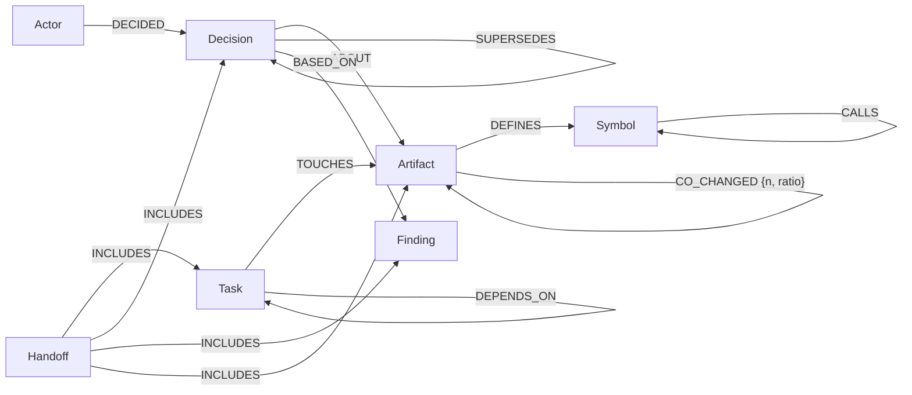

# How baton uses FalkorDB, and why it matters

For readers who want the detail. The short version is in the [README](../README.md). Everything here is checked against the code in
`src/baton/`; where a number comes from a measurement, the source is named. FalkorDB runs as `falkordb/falkordb:v4.22.1` (pinned in
`docker-compose.yml`); the test suite also ran on 6.0.2 earlier.

## 1. Why a graph: three questions a notes file or vector store cannot answer cheaply

**Q1. "If this finding is wrong, which decisions are now unsafe?"** Decisions cite what they were based on, and those decisions are cited
by later ones. One traversal follows the chain to any depth (`graph/queries.py`):
```cypher
MATCH (root:Finding {id: $id})<-[:BASED_ON*1..]-(d:Decision)
RETURN DISTINCT d
```
A flat file has to be grepped, repeatedly, once per new hit. In the benchmark ([RESULTS-PROVENANCE.md](RESULTS-PROVENANCE.md)) the graph found
exactly the derived decisions on 25 generated graphs (precision 1.000, recall 1.000, 2.7 ms median). Grep over notes that cite sources
by id or quote did as well, but dropped to recall 0.65 when citations were mixed with paraphrase and found nothing when all were paraphrased.
A vector search would return "similar" notes, not "derived from" notes. The caveat: the graph is only as good as the recorded `based_on`
links (recall 0.73 when 20% were missing).

**Q2. "I just changed `get_order`'s signature. Who calls it, and is anyone editing those files right now?"** Code symbols and call sites
are nodes and edges; live leases are on tasks that touch files. One query returns the callers (`core/codegraph.py`):
```cypher
MATCH (c:Symbol)-[:CALLS]->(s:Symbol)
WHERE s.path = $path AND s.qual IN $quals AND c.path <> $path
RETURN s.qual, c.path, c.qual ORDER BY c.path
```
and one more joins the result with sessions working in those files:
```cypher
MATCH (t:Task {status: 'claimed'})-[:TOUCHES]->(a:Artifact)
WHERE a.path IN $paths AND t.owner <> $actor_id AND t.lease_until >= $now
RETURN t, a.path
```
A text search finds the word `get_order`; it does not know which hits are calls, nor who holds a lease on them.

**Q3. "Which files usually change together with the one I am editing?"** Learned from git history and stored as weighted edges
(`core/cochange.py`):
```cypher
MATCH (a:Artifact {path: $path}) OPTIONAL MATCH (a)-[r:CO_CHANGED]->(b:Artifact)
WHERE r.n >= $min_n AND r.ratio >= $min_ratio
RETURN a.cc_commits, a.hot, a.dep_files, b.path, r.n, r.ratio
ORDER BY r.ratio DESC, r.n DESC, b.path LIMIT $lim
```
It is one indexed lookup plus edge filtering: p50 0.3 ms, p95 0.4 ms on flask and fastapi checkouts ([RESULTS-COCHANGE.md](RESULTS-COCHANGE.md)).

## 2. Data model

Verified against `src/baton/graph/schema.py` (labels and relationship types) plus `CoChangeIndex`, a bookkeeping node created in
`core/cochange.py`.



Rules people state in conversation are `Decision` nodes with `kind: 'rule'` and no `ABOUT` edge. Every session owns an implicit `Task`
whose lease is renewed on each edit; its `TOUCHES` edges are the live footprint other sessions are warned about. Property lists are in the
README.

## 3. Which FalkorDB capability each feature uses

| Feature | FalkorDB capability | Where |
|---|---|---|
| Claim a task so only one session wins | A single `MATCH ... WHERE ... SET ... RETURN` is atomic, and writes to a graph are serialized, so at most one caller gets a row back | `CLAIM_TASK` in `graph/queries.py` |
| Why / retraction / blast radius | Variable-length traversal `[:BASED_ON*1..]` (and `*1..8` in the Browser demo) with `RETURN DISTINCT` | `BLAST_FROM_*`, `WHY_*` in `graph/queries.py` |
| Batch writes of symbols, call edges, co-change counts | `UNWIND $list AS x ... MERGE / CREATE` with parameters, so a whole file or a batch of commits is one query | `core/codegraph.py`, `core/cochange.py` |
| Code symbol graph | `(:Artifact)-[:DEFINES]->(:Symbol)`, `(:Symbol)-[:CALLS]->(:Symbol)`; a file's symbols are replaced as a unit with `DETACH DELETE` then `CREATE` | `core/codegraph.py` |
| Co-change hints | Weighted `CO_CHANGED` edges (`n`, `ratio`), incremental by last indexed commit, guarded by a lock node (`MERGE ... WITH s WHERE coalesce(s.lock_until,0) < $now SET ...`) so two sessions do not count the same commits twice | `core/cochange.py` |
| "Many files depend on this" note | `CALL algo.pageRank('Symbol', 'CALLS')` summed per file; top 10% with at least 4 dependent files flagged `hot`. Whole-graph, so cached on a 6-hour timer and run from session start, never per hook | `core/cochange.py` (`refresh_hot`) |
| Fast lookups | Range indexes on `id`, `status`, `path` (see `INDEX_STATEMENTS` in `graph/schema.py`); `bootstrap()` creates them idempotently | `graph/schema.py`, `graph/client.py` |
| Reads never queue behind writes; dashboard cannot write | `GRAPH.RO_QUERY` via `Store.ro_query`; every read helper passes `read_only=True`, and the whole dashboard (`ui/state.py`) uses only that path | `graph/client.py`, `ui/state.py` |
| Isolation between projects | One graph per workspace, name `baton_<workspace>` with unsafe characters replaced, taken from the host's environment and never from model output | `graph_name()` in `graph/client.py` |
| No injection from other sessions' text | Queries are fixed strings with `$params`. The only string formatting in queries are integer limits and a label name chosen from a fixed pair | `queries.py`, `core/*.py` |

Notes on the last row: `provenance.retract` formats the node label (`Decision` or `Finding`) into the query from a fixed choice, and
`ui/state.py` formats integer constants into `LIMIT` clauses (FalkorDB does not accept parameters in `LIMIT`).

## 4. Measured latencies

From the repository's recorded results:

| Measurement | Result | Source |
|---|---|---|
| 32 workers racing to claim one task | exactly one winner in 400/400 rounds; p95 about 1.9 ms. A non-atomic read-then-write control double-claimed in 200/200 rounds | [SPIKES.md](SPIKES.md) |
| Retraction blast radius, ~66 derived decisions in ~203 items | 2.7 ms median | [RESULTS-PROVENANCE.md](RESULTS-PROVENANCE.md) |
| First co-change index of 800 commits | 0.3 s (flask), 0.16 s (fastapi); re-run with no new commits 12-16 ms | [RESULTS-COCHANGE.md](RESULTS-COCHANGE.md) |
| Co-change hint query | p50 0.3 ms, p95 0.4 ms | same |
| PageRank refresh / cached check | 2-4 ms / 0.2-0.5 ms (flask, fastapi) | same |
| Whole `baton pre-tool` process | about 140-200 ms with or without the hint, difference within noise; most of it is starting Python | same, [SPIKES.md](SPIKES.md) |

Measured again on 2026-10-18 for this page, in a throwaway graph (`baton_dd_...`, dropped afterwards) on local FalkorDB 4.22.1: 2000
decisions in a single `BASED_ON` chain, 200 files, 50 tasks, the repository's own queries, one client:

| Query | p50 | p95 |
|---|---|---|
| `CLAIM_TASK` (49 claims) | 0.25 ms | 0.36 ms |
| Live leases for a path (read-only) | 0.26 ms | 0.37 ms |
| Recent changes near a file (read-only, 2000 decisions) | 3.8 ms | 6.1 ms |
| `why` up to 8 levels (read-only) | 0.27 ms | 0.42 ms |
| Blast radius over a 2000-deep chain, 2000 results (read-only) | 23.5 ms | 48.9 ms |

The last row is a deliberately extreme chain; real provenance chains are short. These are floor numbers for tiny graphs on one machine,
not scale claims.

## 5. What FalkorDB does and does not give us

- **Writes are serialized per graph, in order.** That is what makes the claim atomic with no extra locking, and it is verified with a race
  test and a control that fails. The cost: one busy project is one write queue. Coordination writes are tiny (about 0.25 ms), so this does not
  matter here. Writes to different graphs overlap (2.1x with 8 threads on 8 graphs vs 1.2x on one graph, in a heavy-write spike), so one graph
  per workspace is also the way to scale out. Reads run in parallel; do not read this as "readers are never blocked": one read stalled
  230-630 ms during a very large write in the spike, cause not investigated.
- **No multi-query transactions.** A single query is atomic; several are not. baton keeps anything that must be atomic in one query (the claim),
  and makes multi-step writes safe to repeat: `MERGE`, idempotent ids, a handoff that rewrites its `INCLUDES` edges. A crash between two queries can
  still leave a partial write, for example a decision without its `ABOUT` edge.
- **Graph algorithms look at the whole graph.** `algo.pageRank` is not per-file, so baton caches the result and recomputes on a timer. It is not benchmarked; only the mechanism is tested
  with a synthetic call graph.
- **Cypher quirks we hit or avoided.** Parameters are not accepted in `LIMIT`/`SKIP` (integers are inlined after validation).
  `shortestPath` works only inside `WITH`/`RETURN`. Details: [research/03-falkordb-capabilities.md](research/03-falkordb-capabilities.md).
- **Not yet covered:** network faults, replicas, very large graphs. The research page tested at 545 nodes, not real scale.
- **Trade-off to be upfront about:** each hook is a new short-lived Python process (about 90 ms cold), so most of a hook's time is startup,
  not the database.

## 6. What we deliberately do not use

- **Vector search.** FalkorDB supports it (we tested vector KNN at about 0.34 ms and a hybrid vector-to-graph query in 2.4 ms in the research notes). We do not use it because it needs an
  embedding for every note, and baton's hooks run with no API key and no model call. Everything baton stores is deterministic, so the same edit
  gives the same record. The cost is real: there is no "find notes that mean the same thing" lookup, and rule capture is keyword-based.
- **Full-text index**, **graph copy for what-if retraction**, **GRAPH.PROFILE panel**, **unique constraints**, other algorithms (community detection, betweenness). Tested in
  the research notes, not shipped. Duplicate-artifact protection currently relies on `MERGE`, not a constraint.
- **Multi-statement transactions (`MULTI/EXEC`)**: unnecessary so far, and they serialize other graphs too.

## 7. Why this is not decoration: what breaks if you remove FalkorDB

Take the graph away and what is left is a pile of notes. The atomic claim becomes a lock file or a race (the control in the spike double-claimed every
time). "What did this decision depend on" becomes a repeated search that fails when notes paraphrase their sources (recall 0.65 mixed, 0 paraphrased). "Who
calls this function" needs a call index that you would have to build and keep consistent, and the answer must be joined with who is editing which file right now.
The co-change hint is a weighted edge lookup that needs the same kind of index. Each feature is a path through
the same graph: a collision warning, a broken-caller warning and a retraction all start from the same `Artifact` and `Task` nodes.

What the graph does not prove: that these warnings make sessions produce better code. See the [README](../README.md#does-it-work) for what is and is not shown.

## 8. Explore the graph yourself

```sh
docker compose up -d
.venv/bin/python demo/run_demo.py          # builds graph baton_demo
```
Open http://localhost:3000 (FalkorDB Browser), choose `baton_demo`, and paste queries from [`demo/queries.cypher`](../demo/queries.cypher). The file has nine:

1. the whole graph (`MATCH p = (n)-[r]->(m) RETURN p LIMIT 100`)
2. who is working on which file now (live leases)
3. decisions about `shop/db.py` by others, which is what the collision warning is built from
4. everything a decision was transitively based on (`BASED_ON*1..8`)
5. the blast radius of a finding, with current statuses
6. the latest handoff and what it includes
7. callers of `get_order`, from the code graph
8. which files call into `shop/db.py`, and how often
9. symbols nothing calls

`baton ui` shows the same graph in a read-only dashboard. To profile any query yourself: `GRAPH.PROFILE baton_demo "<query>"` from `redis-cli`.
