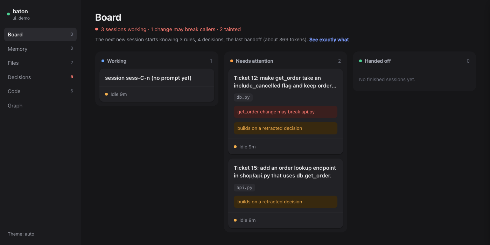
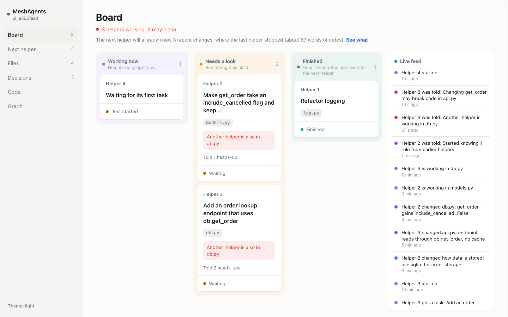
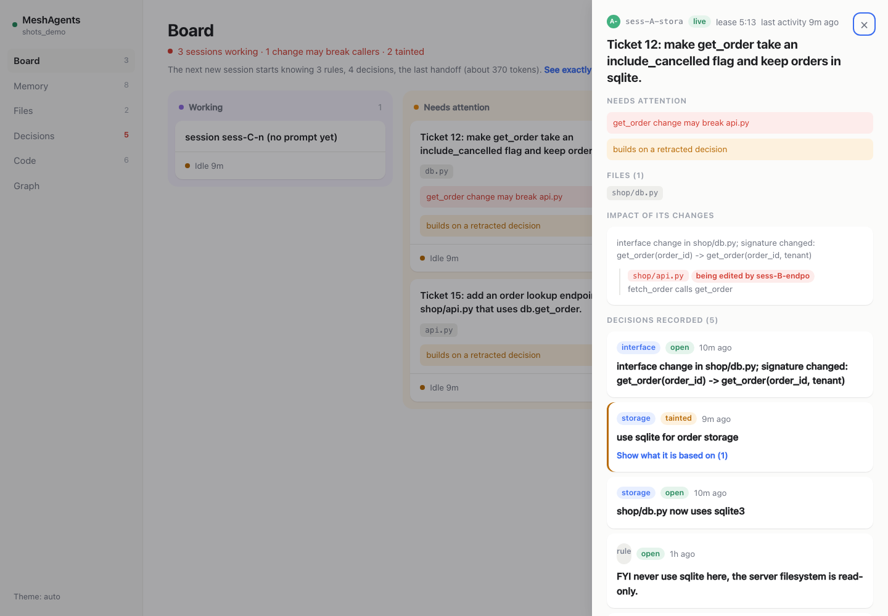
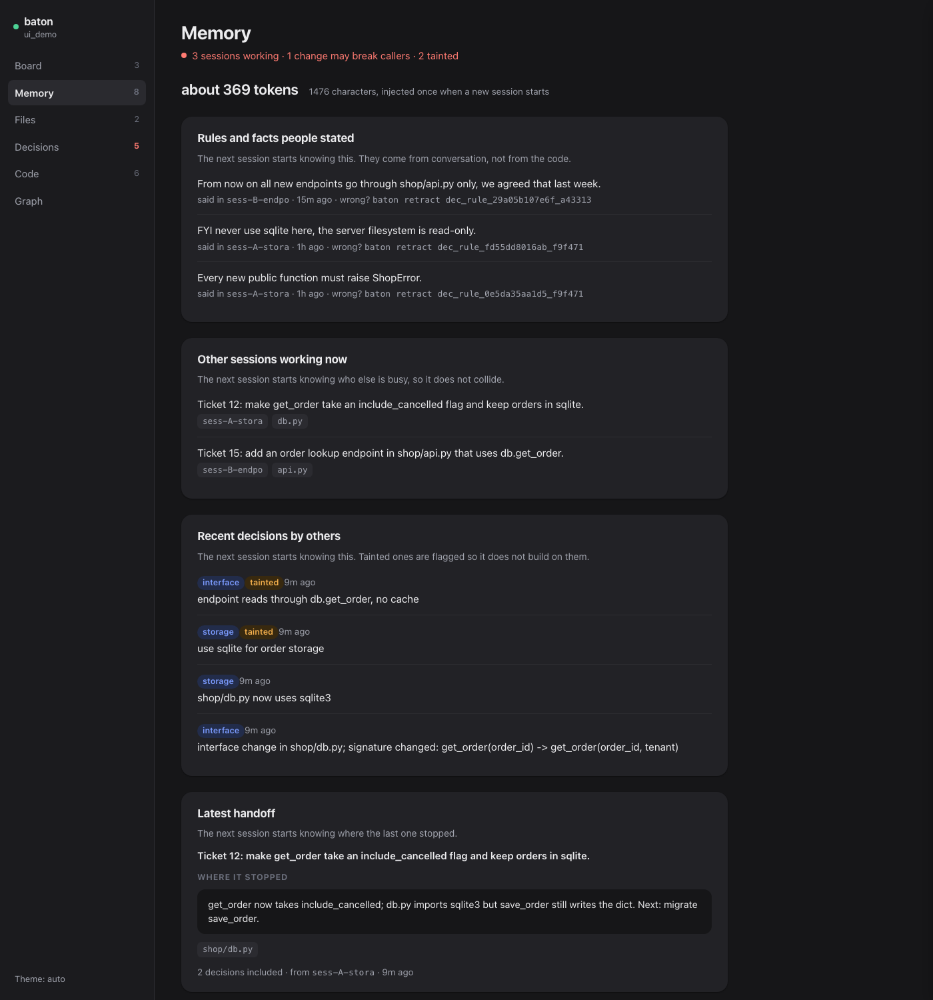
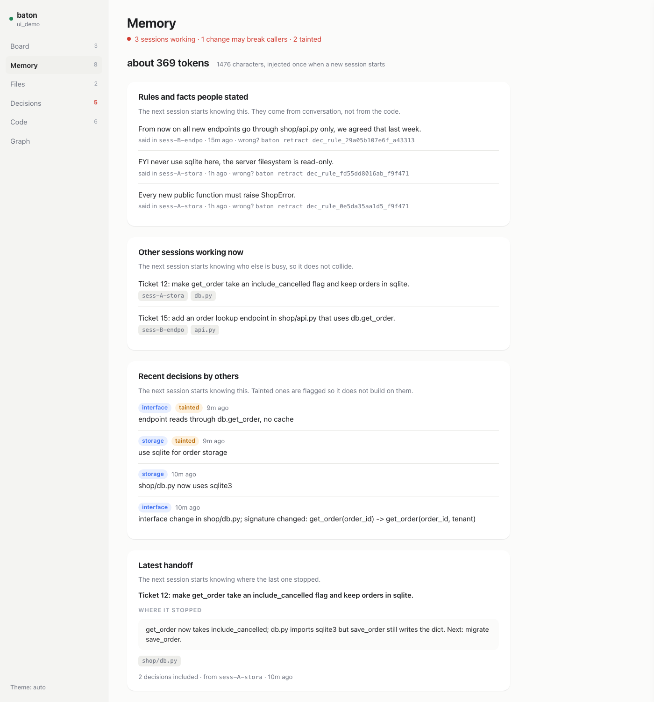
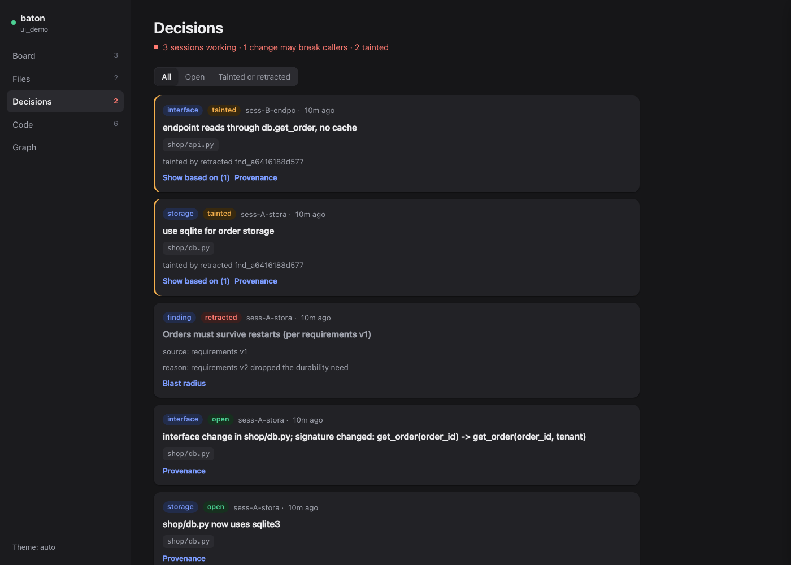
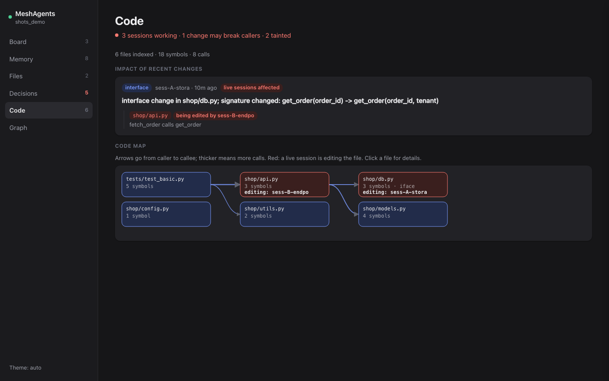
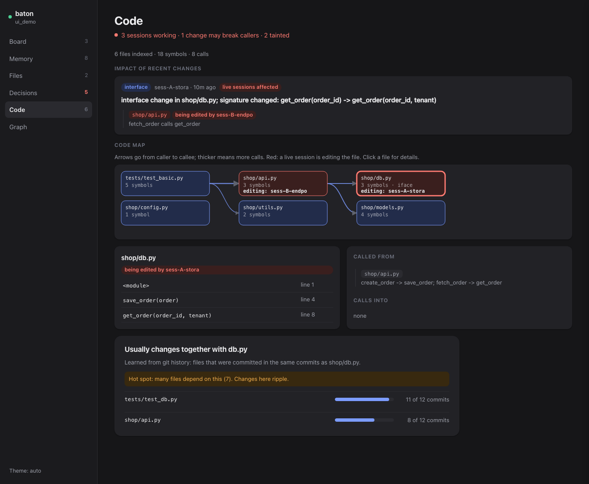
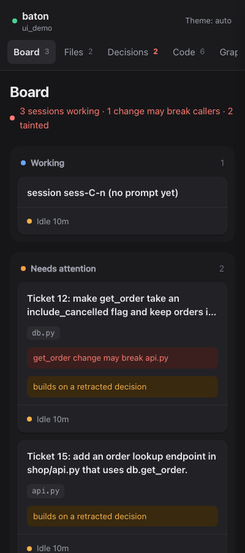

# Dashboard and command line

Hooks are baton's main product. These are the human-facing views of the same graph.

```sh
baton ui [--port 7777] [--workspace NAME]   # prints http://127.0.0.1:7777, opens nothing
baton status [--json]                       # live sessions, leases, shared files, latest decisions
baton why <decision-or-finding-id>          # what it was based on, and what depends on it
baton retract <id> --reason "..." [--yes]   # asks first; prints the decisions that became tainted
baton handoff                               # latest handoff briefing
baton impact <path>                         # callers of a file's public symbols, and who is in those files
baton together <path>                       # files that usually change with it (git history)
baton brief                                 # exactly what a new session would be told now, with a token estimate
baton rules                                 # captured rules with ids (retract a wrong one: baton retract <id>)
```

All commands pick the workspace the way the hooks do (`--workspace` or `BATON_WORKSPACE` override it).



## First screen: the board

One plain sentence says whether anything is wrong ("2 sessions working", or "... 1 collision risk"), and a three
column board shows who is doing what:

- **Working**: live sessions with nothing wrong.
- **Needs attention**: live sessions that share a file with another live session, whose interface change may break
  callers elsewhere, or that build on a retracted decision. The card says why in one line.
- **Handed off**: finished sessions (and ones whose lease ended).

Each card is the session's goal, up to two files, and a status line ("Editing db.py", "Idle 3m").



Click a card for the details in a slide-over (Esc or a click outside closes it): files, lease countdown, what else
touches those files, impact of its changes on callers, the decisions it recorded with their "based on" chain, and its
handoff. `#session/<id>` in the URL deep-links to a card.



## Other views (sidebar)

- **Memory**: exactly what the next new session would be told right now, as cards: rules and facts people stated (who, when,
  and the command to retract a wrong one), other sessions working, recent decisions, and the latest handoff including the
  full request it was given. It shows "about N tokens" for the whole briefing. The Board shows a one-line version.
  `/api/memory` mirrors `sessions.briefing` read-only (the real function marks the handoff as imported, a dashboard must not write);
  a test pins the two texts together.
- **Files**: files touched (click one to see what changes with it), with the sessions in each; shared files are flagged.
- **Decisions**: newest first, filter All / Open / Tainted or retracted. "Provenance" draws the why-chain and blast
  radius and previews what a retraction would taint (read-only; retract from the terminal).
- **Code**: impact of recent interface changes (callers elsewhere, flagged when a live session is in that file) and
  the code map: files as nodes, caller to callee arrows weighted by call count. Click a file for its symbols and callers, and a "Usually changes together with" panel: the files committed in the
  same commits (n of N, with a bar) and a hot-spot note when many files depend on it (`/api/together?path=...`, path validated).
- **Graph**: overview of tasks, files, decisions and findings (150 nodes max).







The page polls every 1.5 s and updates cards in place, so scroll position and an open panel stay put. If FalkorDB is
down it shows a banner and keeps polling. It follows the system light/dark setting; the sidebar button overrides it.
Below 860 px the sidebar becomes a tab row and the columns stack.



## Security notes

- Binds `127.0.0.1` by default; requests whose `Host` header is not local are refused (DNS rebinding).
- GET only. There are no write endpoints; every query goes through `ro_query`. Retraction is CLI-only.
- Decision and finding text comes from other sessions and is untrusted. The API returns it as raw JSON; the page
  builds the DOM with `textContent` only (a test fails if `innerHTML` appears), and a CSP forbids external loads.
- Responses are capped (60 code files, 100 decisions, 60 tasks, 80 files, 150 graph nodes, 1.5 MB body).
- `baton handoff` records that a human imported the handoff, like any other session would.
- No dependencies, no CDN, no build step: one HTML file in `src/baton/ui/static/`.
