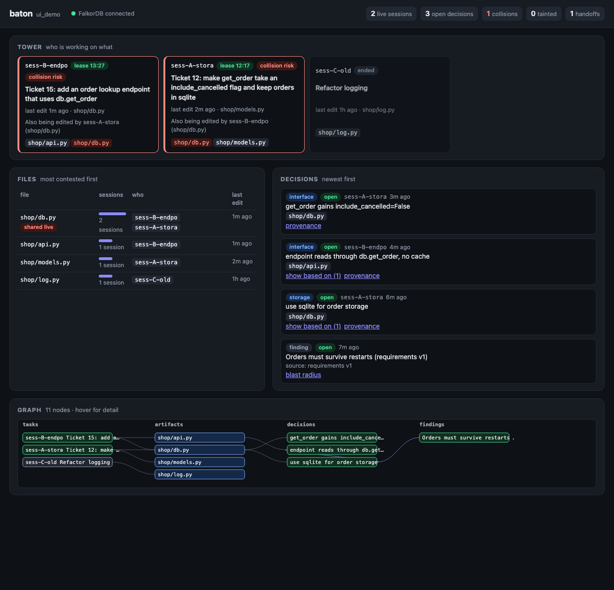
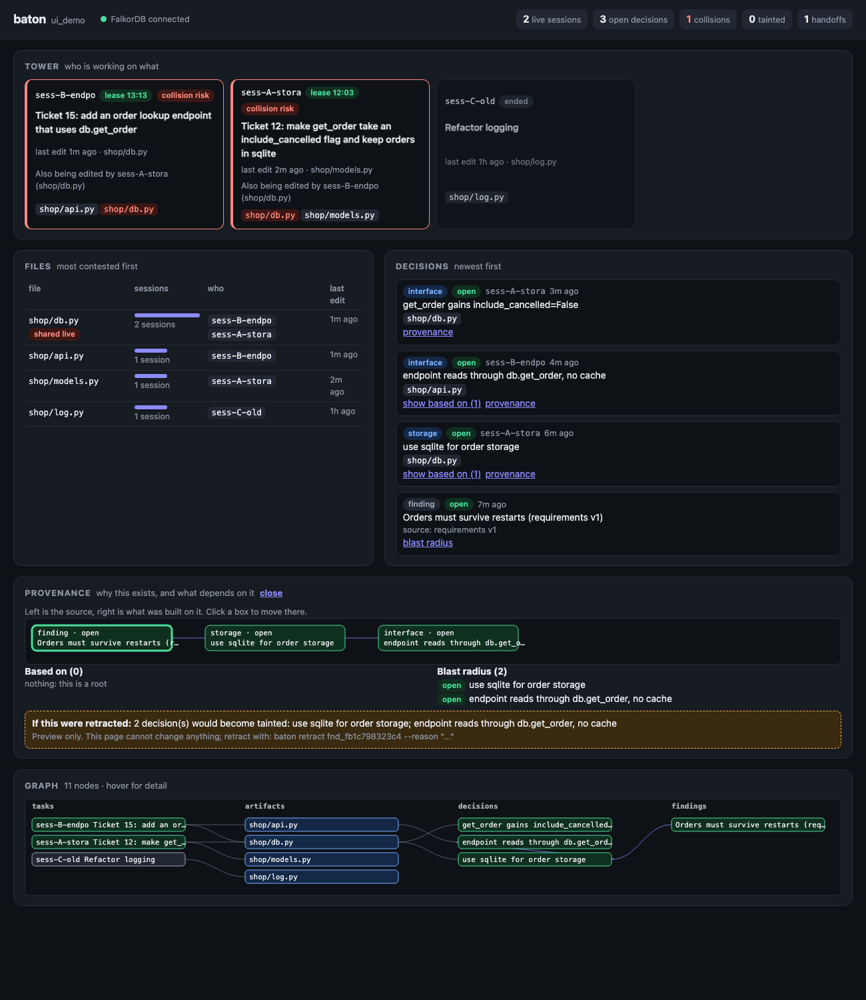

# Dashboard and command line

Hooks are baton's main product. These are the human-facing views of the same graph.

```sh
baton ui [--port 7777] [--workspace NAME]   # prints http://127.0.0.1:7777, opens nothing
baton status [--json]                       # live sessions, leases, shared files, latest decisions
baton why <decision-or-finding-id>          # what it was based on, and what depends on it
baton retract <id> --reason "..." [--yes]   # asks first; prints the decisions that became tainted
baton handoff                               # latest handoff briefing
```

All commands pick the workspace the way the hooks do (`--workspace` or `BATON_WORKSPACE` override it).



## Views

- **Header**: workspace, FalkorDB connection, counts of live sessions, open decisions, collisions, tainted decisions, handoffs.
- **Tower**: one card per session, live first: goal, files touched, last edit age, lease countdown. Sessions that
  edit the same file get a red "collision risk" badge naming the other session and the shared files.
- **Files**: files ordered by how many sessions touched them, contested first.
- **Decisions**: newest first, with kind (interface, config, storage, rename, note), author, files and status
  (open, superseded, retracted, tainted). "show based on" expands the upstream chain.
- **Provenance**: "provenance" or "blast radius" opens a layered graph: sources left, derived decisions right, plus a
  preview of what retracting the item would taint. The preview is read-only. The URL fragment `#id=<id>` deep-links to it.
- **Graph**: deterministic overview of tasks, files, decisions and findings (capped at 150 nodes); hover for detail.
- With an empty graph the page shows the three start commands instead.



The page polls `/api/state` every 1.5 s. If FalkorDB is down it shows a banner and keeps polling.

## Security notes

- Binds `127.0.0.1` by default; requests whose `Host` header is not local are refused (DNS rebinding).
- GET only. There are no write endpoints; every query goes through `ro_query`. Retraction is CLI-only.
- Decision and finding text comes from other sessions and is untrusted. The API returns it as raw JSON; the page
  builds the DOM with `textContent` only (a test fails if `innerHTML` appears), and a CSP forbids external loads.
- Responses are capped (100 decisions, 60 tasks, 80 files, 150 graph nodes, 1.5 MB body).
- `baton handoff` records that a human imported the handoff, like any other session would.
- No dependencies, no CDN, no build step: one HTML file in `src/baton/ui/static/`.
